  

### transmission

Hey, I'm Anh! 👋

I come from a background in healthcare, AI, data, and technical operations. I like figuring out how things work, troubleshooting problems, and building random things that probably didn't need to exist.

This is my little corner of the internet where I experiment, recreate things, try out new tools, and occasionally build something useful.

Some projects are practical. Some are questionable. Most are just for fun. ☕️

### endpoints

🔗 [LinkedIn](https://www.linkedin.com/in/anh-lam09/)
